# PRİZMA 0.7.0 — Aydınlık casual görsel yenileme

Mevcut 0.6.0 projesi yenilendi. Yeni bölüm, mekanik, mağaza, satın alma veya kayıt sıfırlama eklenmedi. 75 bölüm, iki dünya, bütün Match-3 kuralları ve 12 mekanik korunur. Normal kristal dokunarak patlamaz.

Başlangıç kaynak commit'i `1b9248ca904568f921211f1d8775fc819e3b5597`; Git geri dönüş etiketi `backup/before-casual-redesign-v0.6.0`. Bütün geçmişi içeren yerel Git bundle doğrulandı. Önceki ekranlar bu commit'in `git archive` kopyasında gerçek Godot renderer ile alındı; önceki oyunun kaynakları değiştirilmedi.

## Önce / sonra

Aşağıdakiler gerçek uygulama ekran görüntüleridir; konsept çizimleri değildir. Aynı 540×960 oyun geometrisi kullanılır.

| Ekran | Önce, 0.6.0 | Sonra, 0.7.0 |
|---|---|---|
| Ana menü | 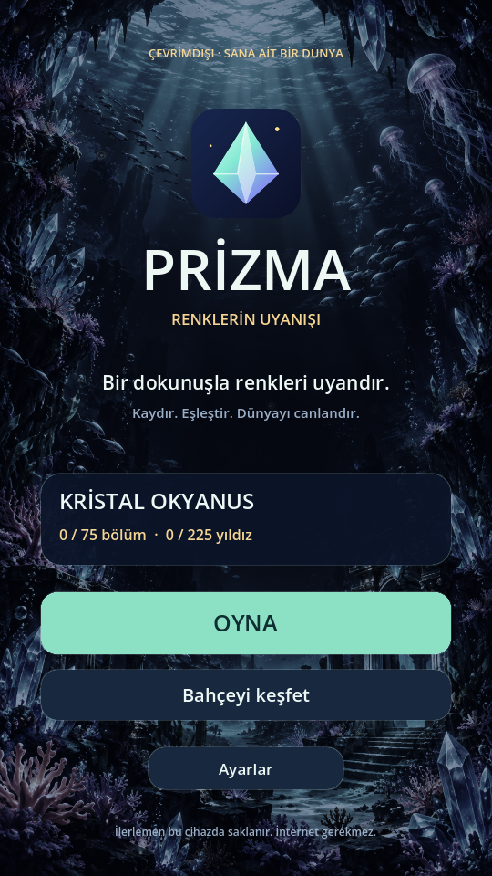 | 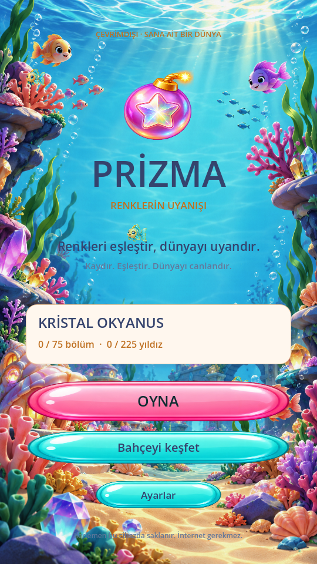 |
| Bahçe haritası | 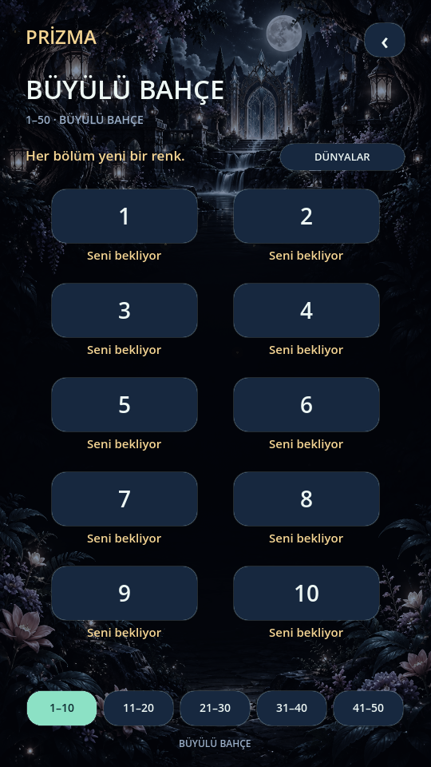 | 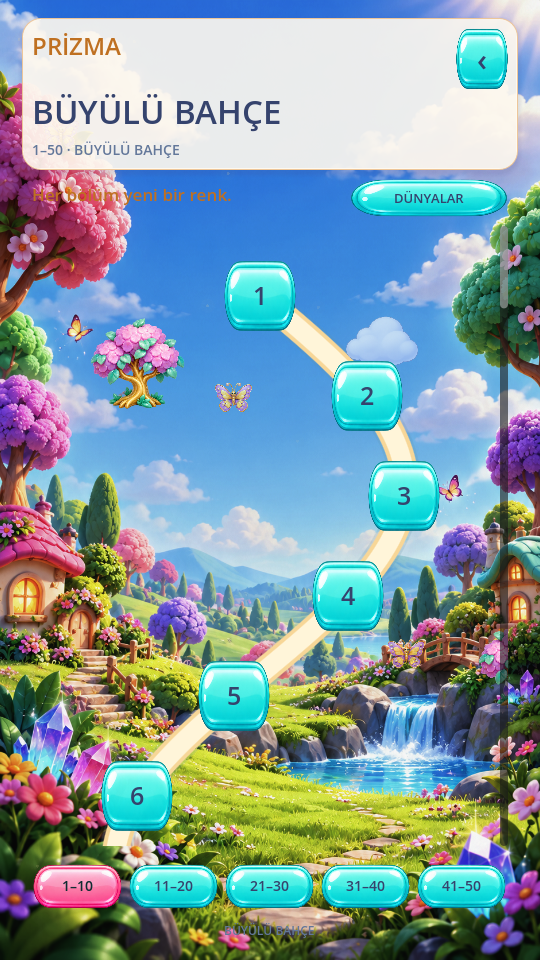 |
| Okyanus, bölüm 51 | 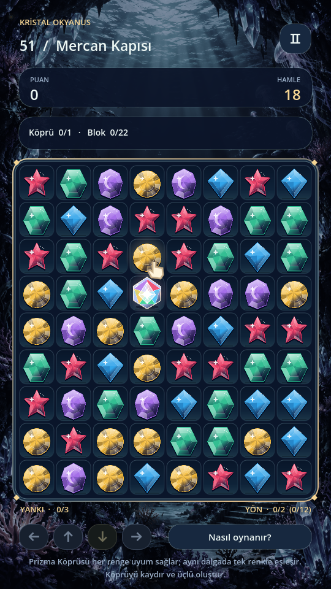 | 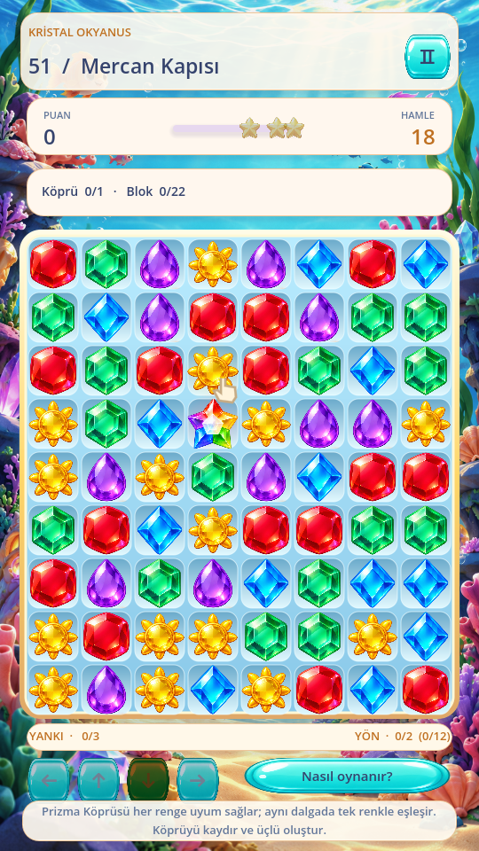 |

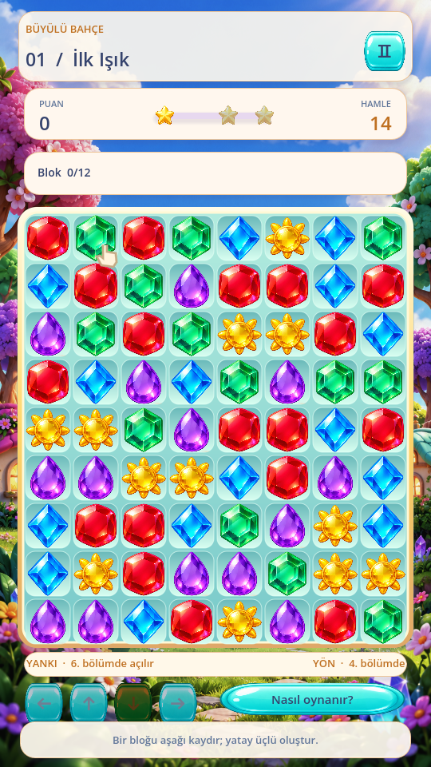

## Görsel tasarım ve gerçek varlıklar

Özgün sanat üretim aracıyla bu revizyona özel 67 ayrı sprite içeren altı PNG atlası ve iki portre dünya resmi üretildi. Üçüncü taraf oyun görseli, hazır emoji veya Unicode kristal kullanılmadı. Kaynak PNG'ler değiştirilmeden korunur; `tools/index_casual_assets.py` yalnızca şeffaf silüetlerin kaynak koordinatlarını hesaplar. Dosya boyutları, sprite sayıları ve SHA-256 değerleri [varlık manifestinde](redesign/asset-manifest.json), bütün kaynaklar `assets/casual/` içindedir.

| Dosya | İçerik |
|---|---|
| `gems.png` | Yakut, elmas safir, altıgen zümrüt, güneş, ametist; iki roket, prizma ve renk bombası: 9 sprite |
| `mechanics.png` | Tohum/filiz/çiçek, iki buz, üç taş, beş renk kilidi; yaprak, parıltı, kristal parçası: 16 sprite |
| `traits.png` | 10 çift renk, 5 bukalemun, köprü, iki çivi, madalya ve parıltı: 20 sprite |
| `devices.png` | Portal giriş/çıkış, sarmaşık, iki sandık, iki ayna, ahşap parça: 8 sprite |
| `ui.png` | Pembe ve turkuaz düğme, krem panel kaynağı, yıldız, kilit, bulut: 6 sprite |
| `decor.png` | Ağaç, ev, çiçek, kelebek; mercan, balık, yosun ve deniz yapısı: 8 sprite |
| `world-garden.png` / `world-ocean.png` | Aydınlık bahçe ve sığ kristal okyanus; özgün, portre illüstrasyonlar |
| `board-frame.svg` / `board-ocean.svg` | Özgün vektör çerçeveler ve 72 hücre; aynı 56 px hücre / 60 px adım |

Kristaller hem şekil hem renk ile ayrılır. Kaynak bölgeleri orantılı sığdırılır; farklı sprite oranları hücre içinde gerilmez. Buz ve çivi açık merkezlidir. Dayanıklılık ve iki ayna yönü farklı sanat durumlarıyla gösterilir. Görseller geçici yer tutucu olarak kullanılmadı. Krem HUD kartları okunabilirlik için hafif vektör stiller kullanır; bütün düğmeler gerçek glossy atlas görsellerini kullanır.

Dünyanın renklerle canlanma hikâyesi korunur; başlangıçta doygunluk en az %76, parlaklık en az %96'dır. Siyah/gri dünya oluşturulmaz. Kalite ayarına göre sınırlı kelebek/balık ve baloncuk hareketi kullanılır. Performans ve azaltılmış hareket seçenekleri korunur.

## Arayüz ve animasyon

- Dünya haritası sabit 2 sütunlu bölüm listesinden, kıvrımlı yola ve gerçek dikey dokunmatik kaydırmaya dönüştürüldü. Bahçe 50, Okyanus 25 gerçek düğüm içerir. Yıldızlar, kilitler, mevcut bölüm parlaması ve temalı dekorlar eklenir. Grup kısayolları aynı yol içinde ilgili konuma gider; 76+ oynanabilir düğüm yoktur.
- Android `ScreenTouch`/`ScreenDrag`, sürükleme eşiği, parmak oyun alanının dışına çıksa da devam etme, kaydırma sırasında yanlış bölüm seçimini engelleme ve kısa momentum ayrı kontrol edilir. Fare emülasyonuna bağlı değildir.
- Açık renkli başlık/puan/hedef kartları, gerçek puan eşikleriyle dolan yıldız çubuğu, animasyonlu puan ve sıralı başarı yıldızları eklendi. Başarı ekranı konfeti ve mevcut tekrar/sonraki bölüm akışını korur. Başarısızlık ekranı mevcut dostça yönlendirmeyi kullanır.
- Kristal parçaları ve yapraklar gerçek atlas sprite'larıdır. Büyük eşleşmeler daha fazla parçacık, güç oluşturma ışınları ve renkli enerji yörüngeleriyle ayrılır. Kombo yazısı kalın yazı, renkli kontur/gölge ve kısa büyüme animasyonu kullanır.
- Renk bombası temizlenecek hücrelere kısa ışık bağlantıları ve gecikmeli kozmetik temizleme/parçacık gösterir. Mantıksal sonuç önce hesaplanır; bu görünüm puan/hamle/tahta sonucunu değiştirmez.
- Takas 180 ms, geri dönüş 140 ms, normal temizleme 210 ms, renk bombası 300 ms; düşüş 150 ms, dolum 170 ms. Azaltılmış hareket kısa oynatma kullanır. Oluşan özel güç kendiliğinden mantıksal olarak etkinleştirilmez.

[Gerçek render animasyon videosu](https://github.com/hakannnyalcinnn/tonton-akademi-v1-2/releases/download/v0.7.0/prizma-redesign-report.zip) rapor ZIP'indeki `prizma-casual-animations.mp4` dosyasıdır. Normal/4/5 eşleşme, özel güç birleşimi ve laboratuvarda gerçek renk bombası etkinleştirmesi toplam 141 renderer karesinde kaydedildi; video 30 kare/sn örnekleme ile oluşturuldu. Ses kapalı video insan veya Android cihaz kaydı değildir. Sonuç ekranı için 75. bölümün canonical seed'i robotla gerçekten kazanılarak son kare alınır; diğer başlangıç/laboratuvar ekranları izole test profilleri kullanır.

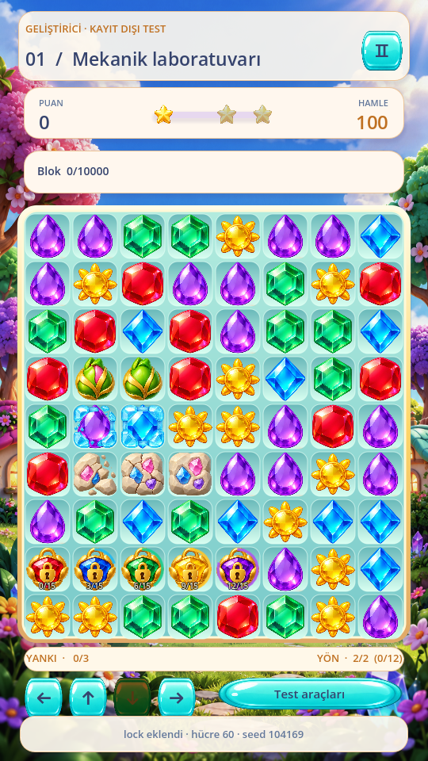
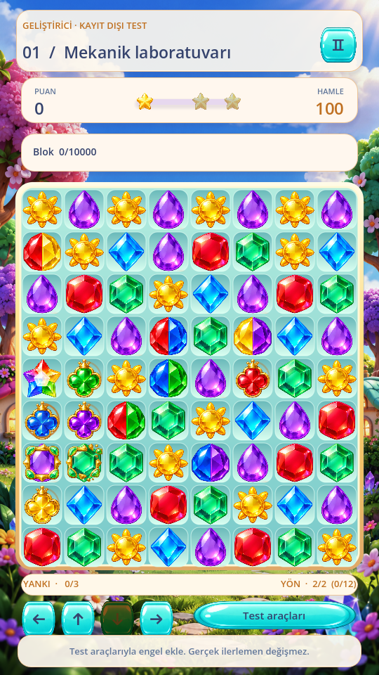
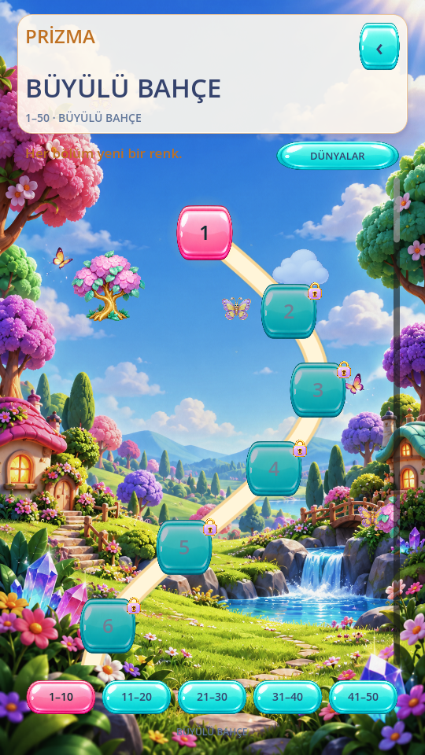
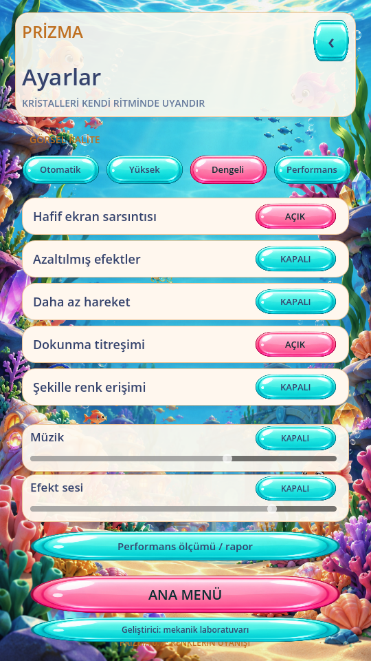
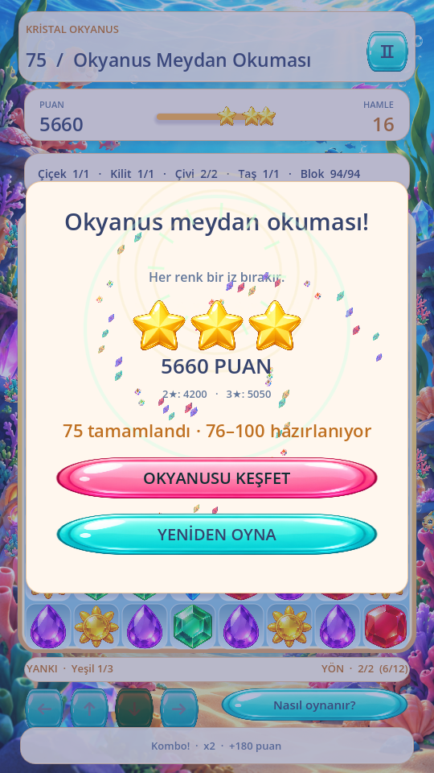

## Mantığın korunması ve performans yaklaşımı

`scripts/core/`, `scripts/mechanics/` ve `data/` başlangıç sürümüyle bayt düzeyinde aynı kalır. Oyun ve kayıt şeması değiştirilmedi. 8×9 tahta, hücre merkezleri, güvenli alan / ekran oranı hesabı ve sürükleme motoru korunur. Görsel animasyonlar olay kuyruğunu oynatır; mantıksal hücre yazımı yapmaz.

Atlaslar ve kaynak dikdörtgenleri önceden yüklenir; sürükleme sırasında dosya okunmaz. Kristaller sahne düğümü değildir; mevcut tek çizim yüzeyi kullanılır. Tahta altı çerçeve, dört puan etiketi ve bir kombo etiketi dahil sabit **6 alt düğüm**, sabit **192 parçacık slotu** korunur. Düşük kalite/azaltılmış efektler bütçeyi kısar. Harita ayrı ekran olup oynanış sırasında çizilmez; sahneye bağlı tween'ler ekran kapanınca bırakılır. Eski dünya resimleri ve mekanik atlasları Git'te kalır fakat Android paketinden dışlanır.

Test kapanışında Dummy ses karıştırıcısında aralıklı kaynak bırakılması görüldü. İlgili UI testinin kapanışı, oynatıcılar hâlâ ağaçtayken durdurma ve karıştırıcının emekliye ayırmasını bekleme ile düzeltildi. Üretim ses mantığı değiştirilmedi. İlk başarısız çalıştırma gizlenmedi; son doğrulama sonuçları aşağıdadır.

## Otomatik test ve ölçüm sonuçları

**76.557 kontrol, 0 başarısızlık.** Tam motor/bölüm/regresyon paketi yeniden çalıştırıldı; son arayüz düzeltmelerinden sonra ilgili UI testleri yeniden geçti. GitHub CI aynı bütün paketi yayımlama öncesinde tekrar çalıştırır. 2.000 başlangıç tahtası; ilk 10 bölümde 1.000 oyun, 11–30'da 600, 31–50'de 400, 51–75'te 500 oyun (toplam 2.500 oyun / 12.624 hamle). Ek olarak geliştirici senaryolarında 100 tahta / 600 eylem, karışık 12 mekanik ve deterministik yeniden oynatma doğrulanır. Kayıtlar, geçersiz takas, son hamle zincirleri, dört yön, özel güçler, rezonans ve pause/resume testleri korunur.

Dört native stres grubu toplam 400 geçerli + 400 engellenen ikinci kaydırma geçirdi. Son kaynakta gerçek renderer ile ilk 10 bölümde ayrıca 100 geçerli `ScreenTouch`/`ScreenDrag`, 100 engellenen ikinci kaydırma ve 10 geçersiz takas çalıştırıldı; her eylemden sonra kararlı tahta doğrulandı. Bunlar Godot'a gönderilen sentetik native olaylardır; fiziksel telefon parmağı ölçümü değildir.

Görsel kontrol: 126 yakut piksel görünürlüğü ve çift renk için 1 iki-renk kapsamı testi geçti. 87 yeni UI kontrolü; parmakla harita kaydırma, yanlış bölüm açmama, 50/25 düğüm, gerçek eşikler, tam eşikte yıldız yerleşmesi, sabit tahta havuzu ve harita/sonuç atlas ikonlarının boyut sınırlarını doğrular. Hazır eşleşme bulunmayan başlangıçlar ve 75 bölümün oynanabilirliği bütün motor paketinde kontrol edilir. Zorlanmış sonsuz zincir ve imkânsız sarmaşık topolojisi testlerinin teşhis uyarıları beklenen kurtarma yollarıdır; başarısızlık sayılmaz.

Son görsel kontrolde iki hata düzeltildi: puan tam eşikte durduğunda yıldız çubuğunun küsuratla eşiğin altında kalması; `TextureRect` boyutunun genişleme modu değiştirilmeden önce atanması nedeniyle sonuç yıldızlarının/kilitlerin kaynak resim boyutuna büyümesi. İkisi için regresyon kontrolleri eklendi. Animasyonların tamamlanmış kareleri yeniden incelendi.

**Ölçüm koşulu:** Godot 4.6.3, Linux/Xvfb, 540×960 pencere, Mesa llvmpipe LLVM 19.1.7 yazılım renderer, `--max-fps 60 --profiling`; testler/ölçümler eşzamanlı yük altında çalıştırılmadı. 16,7 ms kare bütçesi hedeflenir. Aşağıdaki FPS, `1000 / ortalama gerçek kare aralığı` ile hesaplanır.

| Çalıştırma | Eylem | Ortalama FPS | Ortalama kare ms | p95 ms | En büyük ms | Mantık ortalama / en büyük ms |
|---|---:|---:|---:|---:|---:|---:|
| Önce: Okyanus, dengeli | 100 | 59.00 | 16.95 | 18.96 | 188.01 | 3.79 / 20.96 |
| Yeni sanat: Okyanus, dengeli | 100 | 59.16 | 16.90 | 18.11 | 167.06 | 3.99 / 20.66 |
| Yeni sanat: laboratuvar, dengeli | 100 | 59.47 | 16.81 | 16.89 | 308.07 | 2.23 / 5.61 |
| Yeni sanat: Okyanus, performans | 20 | 59.39 | 16.84 | 16.75 | 137.96 | 3.81 / 16.91 |
| Yeni sanat: laboratuvar, performans | 20 | 59.61 | 16.77 | 16.83 | 66.65 | 2.13 / 4.70 |
| Son kaynak: ilk 10 bölüm, native dokunma | 100 + 10 geçersiz | 59.39 | 16.84 | 17.59 | 196.28 | 2.41 / 8.66 |

Okyanus/laboratuvar tabloları yeni sanatın ilk ölçümüdür. Son iki küçük yıldız yerleşme/ikon boyutu düzeltmesinden sonra native 100 kaydırma ölçümü yeniden çalıştırıldı ve son APK aynı kaynakla yeniden derlendi. [Ölçüm kaynaklarının SHA-256 kaydı](redesign/performance/measurement-provenance.json) bu ayrımı açık tutar. Aynı Okyanus senaryosundaki 100 eylemin sahne/seed/karıştırma/zincir dizisi ve 194 zincir dalgası eski ve yeni sanatta aynıdır; bu ölçümden mantık algoritmasının hızlandığı sonucu çıkarılmaz.

Kare sıçramaları kayıtta korunmuştur. Robotun hamle seçmesi, sahne yükleme/geçişleri ve yazılım GPU'su bu uç değerlere dahildir. Bütün karelerin 16,7 ms içinde kaldığı veya telefonda sabit 60 FPS sağlandığı kanıtlanmadı. Laboratuvar ölçümü 100 eylemde 85 takas + 15 özel güç, 20 sahne değişimi ve en fazla 7 ardışık dalga içerir. Her iki performans kalitesinde 20 eylem ayrıca gerçekten çalıştırıldı.

**Son kaynakta işlem ve animasyon ölçümleri:**

| İşlem | Ortalama ms | p95 ms | En büyük ms |
|---|---:|---:|---:|
| Dokunma → görsel çizim komutu gönderimi | 0.113 | 0.600 | 0.827 |
| Sürükleme → görsel çizim komutu gönderimi | 5.543 | 8.357 | 13.519 |
| Takas + otomatik mantık çözümü | 2.414 | 5.020 | 8.657 |
| Takas animasyonu | 184.737 | 192.487 | 196.195 |
| Geçersiz takas geri dönüşü | 148.325 | 150.000 | 150.000 |
| Eşleşme taraması | 0.161 | 0.229 | 1.162 |
| Temizleme mantığı | 0.192 | 0.392 | 0.837 |
| Yer çekimi mantığı | 0.071 | 0.109 | 2.382 |
| Yeni blok üretimi | 0.031 | 0.064 | 0.296 |
| Tahta çizim komutu CPU | 0.371 | 0.564 | 3.761 |
| Viewport render CPU | 1.434 | 2.322 | 12.560 |
| Yazılım GPU render | 8.814 | 11.511 | 40.889 |

Dokunma ölçümleri `_draw` içindeki CPU komut gönderimine kadardır; OS dokunma teslimi, ekran taraması ve parmağın fiziksel başlangıcı dahil değildir. Bu nedenle fiziksel cihazda 80 ms hedefi karşılandı diye sunulmaz. Bazı teşhis dizileri son 2.048 örnekle sınırlıdır; tam kare aralıkları ayrı benchmark dizisinde tutulur. Godot `TIME_PROCESS` monitörünün son tutulan örnekleri ham dosyalarda korunur; bunlar doğrudan kare başına CPU süresi olarak yorumlanmaz. Okyanus yeni sanat ölçümünde Godot statik bellek en fazla 47.569.984 bayttır; bu tüm Android RSS/VRAM değildir. Nesne sayıları kaydedildi; bütün tekil bellek tahsislerinin izleri ölçülmedi.

[Ham ölçümler](redesign/performance), [test özetleri](redesign/automated-test-summary.txt), [bayt düzeyinde değişmeyen 60 dosya](redesign/unchanged-engine.json). Rapor ZIP'i ilgili ham test kayıtlarını ve gerçek render ekranlarını içerir.

## Değişen dosyalar

Görsel kaynaklar `assets/casual/`, parlak uygulama ikonu ve `restore_color.gdshader`; arayüzde `main.gd`, `board_view.gd`, `board_backdrop.gd`, `garden.gd`, `palette.gd`, üç mekanik görsel kontrolcüsü ve `celebration.gd` değişti. Yeni `casual_skin.gd`, `map_path.gd`, `world_scroll.gd`, `star_progress.gd` görsel sorumlulukları ayırır. İlgili yakalama/UI testleri, Android varlık dahil etme/doğrulama kuralları, CI sürüm tanımı ve belgeler güncellendi. Tam liste rapor ZIP'indeki `changed-files.txt` içindedir. Motor/mekanik/bölüm veri dosyaları değişmedi.

## Android ve sınırlar

Paket `com.prizma.renklerinuyanisi.match3`, versionName 0.7.0 / versionCode 7, Android 7+ (minSDK 24), hedef SDK 36, ARMv7 + ARM64. Aynı kalıcı test imzası kullanılır; mevcut Match-3 uygulamasını kaldırmadan üzerine güncellenir. İnternet izni yoktur. APK'ya atlas koordinat JSON'u dahil edildiği ayrıca doğrulandı. İlk doğrulamada Android ZIP kökü ile proje içindeki `assets/` klasörünün birlikte oluşturduğu `assets/assets/casual/` yolunu tek `assets/` sanan kontrol düzeltildi; JSON ilk APK'da da mevcuttu.

Bu buluta gerçek Android telefon bağlı değildir. Telefon FPS'si, fiziksel dokunma gecikmesi, cihaz kurulumu, çentik/sistem çubukları, gerçek OS arka plan geçişi ve hoparlör/titreşim deneyimi doğrulanmış gibi gösterilmez. Masaüstü renderer ve sentetik yerel dokunma testleri telefon ölçümünün yerine geçmez. Android'de **Ayarlar → Performans ölçümü / rapor** ile cihaz JSON'u kopyalanabilir; kaliteli animasyonların öznel tatmin ediciliği cihazda kullanıcı tarafından değerlendirilmelidir.

Yeni geliştirme aşamasına geçilmedi. Bu görsel revizyon tesliminden sonra kullanıcı onayı beklenecek.
