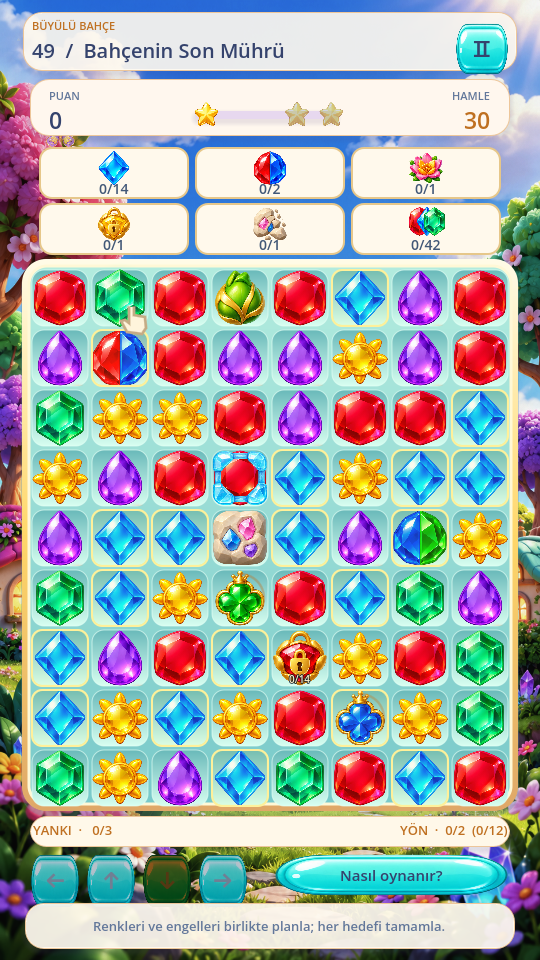
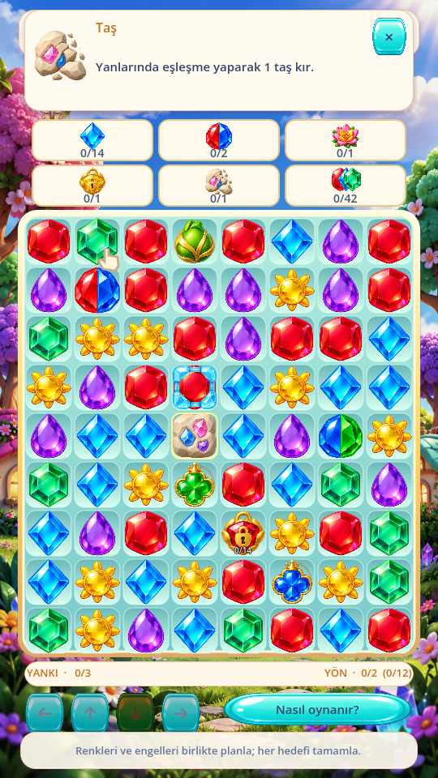
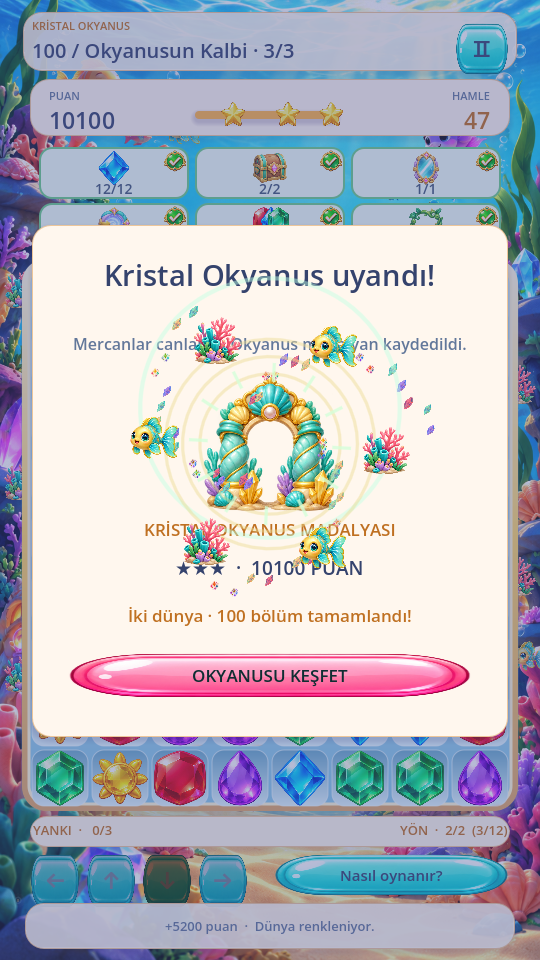

# PRİZMA 0.8.0 — Paket 5 teslim raporu

## Sonuç ve kapsam

Öncelik sırası korundu: çalışan sürüm analiz edilip Git geri dönüş noktası oluşturuldu; hedef paneli ilk 75 bölümde 1.842 kontrolde doğrulandı; sonra Çeşme, Baloncuk, Konveyör ve Mühür geliştirildi; yeni mekanik testlerinden sonra 76–100 ve Okyanus finali eklendi. Son kaynakta panel bütün 100 bölüm için yeniden test edildi.

İki dünya ve 100 gerçek bölüm var. İlk 75 bölümün dört JSON dosyası 0.7.0 ile byte düzeyinde aynıdır; [SHA-256 kanıtı](package5/preserved-levels.json). Match-3 takas, özel güçler, dört yönlü yer çekimi, rezonans, eski mekanikler, kayıtlar, parlak görseller ve efekt havuzları korunur. 17–20 geliştirilmedi. Bu paket sonrasında duruldu.

Geri dönüş: `backup/before-package5-v0.7.0`, kaynak `60322fa03da92f088dbb9bd8acfde2f9279c51de`. Ayrıca çalışma ortamında doğrulanmış Git bundle `/workspace/prizma-tools/before-package5-v0.7.0.bundle` bulunur. Teslim kaynak dalı `prizma-release-v0.8.0`.

## Görsel hedef paneli

Uzun hedef metni kaldırıldı. Kartlarda gerçek atlas ikonu, animasyonlu sayaç, yeşil/altın tamamlanma çerçevesi ve özgün tik medalyonu kullanılır. Normal kristal grubu üç gerçek kristalden oluşur. İkonlar önceden yüklenir; StyleBox'lar kare başına oluşturulmaz.

`goal_registry.gd` bütün mevcut hedef türlerinin ikonunu, Türkçe açıklamasını ve ilgili hücre eşlemesini merkezileştirir. Renk hedefleri, çiçek, buz, taş, renk kilidi, çift renk, dönüşüm, çivi, sarmaşık, sandık, ayna, köprü, portal ve dört yeni mekanik kapsanır. Yeni hedef eklemek kayıt sistemini genişletir; sayılar bölüm verisinden gelir.

Gerçek ilerleme `Board.collected` / `ObjectiveManager` içindedir. Panel mantığı değiştirmez; patlama ve çevre olayları aynı merkezi verinin o aşamadaki kopyasını taşır. Tamamlanma sesi sayaç yeniden çizildiğinde tekrar çalmaz. Kilit üzerindeki enerji ve panelde açılan kilit sayısı açıklamada ayrılır. Kayıt yüklemesi doğru sayaçları kurar.

Bir hedef ortalanır, iki hedef dengelenir, üç hedef tek satırdır; 4–6 hedef iki satırdır. 7+ hedefte açık hedef sayısı ve dokunmatik kaydırma/scrollbar bulunur. Tahta hâlâ 8×9, yerel başlangıcı `(32,270)`, boyutu `476×536`, hücre aralığı 60'tır. Üst başlık ve puan paneli kısaltıldı; tahta dokunma koordinatları değiştirilmedi.

İkona dokunmak üst HUD içinde kapanabilir, oyunu durdurmayan açıklama açar. Taş/buz/renk gibi ilgili nesneler bir saniye hafifçe vurgulanır. Otomatik hamle yapılmaz. Kısa Türkçe hedef öğreticileri `goal_<type>` olarak bir kez kaydedilir; geçilebilir ve Nasıl oynanır → Hedef ikonlarını göster ile tekrar açılır.

## Yeni mekaniklerin kesin kuralları

| Mekanik | Uygulanan davranış | Görsel / giriş |
| --- | --- | --- |
| 13 Boyama Çeşmesi | Sabit cihaz; komşu çizgi eşleşmesinden sonra, kaynak başına oyuncu/özel eylemde bir kez. Manhattan mesafesi ve hücre sırasına göre en yakın üç uygun normal kristal boyanır. Aynı renkteki uygun kristal de yakınlık sırasına dahildir. Özel güç, trait, zırh, sabit ve baloncuk korunur. Boyamanın zincirleri otomatik çözülür. | Özgün kırmızı/mavi sıvılı kristal çeşme, gerçek yapılandırılmış renk rozeti; damla ve renk dönüşümü parlaması. |
| 14 Yüzen Baloncuk | Kristalin hareketli `motion` katmanı. Normal düşüşte geçici bir ayırıcıdır; sonra ters yönün boş koridorunda ilerler. Sabit nesne ve başka kristal aşılmaz. Patlama katmanı kaldırıp kristali korur; yalnızca gerçekten temizlenen kristal renk/toplam hedefine sayılır. Yeniden oluşan eşleşme otomatik çözülür. | Saydam özgün cam halkası, kristal görülebilir; hareket ve kısa su/halka kırılma efekti. |
| 15 Konveyör | Veri dosyasındaki sıralı komşu hücreler hareket yönüdür. Kapalı döngü veya uçtan kristal düşürmeyen kontrollü doğrusal hat. Normal çözümleme ve dolumdan sonra geçerli oyuncu eyleminde bir tur. Önce tüm aktarımlar hesaplanır, sonra eş zamanlı uygulanır. Hedefi boş veya gerçekten boşalacak hücre olan hareketler kabul edilir. Sabit hücre tam dolu döngüyü güvenli biçimde durdurur. | Özgün metal/turkuaz raylar ve üstte okunabilir yön okları; 200 ms taşıma. |
| 16 Şifreli Mühür | Sabit renk dizisi. Her başarılı oyuncu eylemi yalnızca bir giriştir. Normal takasta rezonansın kullandığı tercihli hücre/eşleşme rengi kullanılır; yanlış renk sıfırlar. Özel takas/doğrudan güçte açık kural: seçilen hedef rengi, yoksa motorun deterministik baskın rengi. Zincirler, ücretsiz karıştırma ve enerjiyle yön değiştirme ayrı şifre girdisi değildir. Açıldığında gerçek `seals` sayacı artar, boşluk doldurulup zincirler çözülür. | Özgün kristal mühür; hücre üzerinde sıra/adımlar. Dokununca gerçek kristal ikonlarıyla sıralama gösterilir. Doğru/yanlış enerji, altın açılma efekti. |

Dördü yalnızca geliştirici laboratuvarında bulunur; kampanya katalogu 13–16 içeren normal bölümü reddeder. Test araçlarında dört ayrı düğme ve seed'li sahne vardır; hedef ikonları da laboratuvarda görünür. Gerçek oyuncu ilerlemesi/ödülleri değişmez.

### Etkileşim sınırları

- Çeşme + Çift Renk / Köprü: trait kristalleri boyanmaz; renk alanı ve joker kuralları korunur. Test edildi.
- Baloncuk + dört yönlü yer çekimi: boş koridor, engel, çakışma ve katman koruması test edildi.
- Baloncuk + Portal: portal aynı kristal kimliğini ve hareket katmanını taşır; özel güç hâlâ portal için uygun değildir. Test edildi.
- Konveyör + Portal: ray varışı aynı eylemin portal varış setine girer; boş çıkışa tek aktarım. Test edildi.
- Konveyör + Taş / Çivi: sabit hücre kopyalanmaz, üzerine yazılmaz; dolu engelli döngü durur. Test edildi.
- Mühür + Rezonans: aynı normal hamle rengi, zincirde ikinci giriş yok. Mühür + özel güç: yukarıdaki seçilen/baskın renk istisnası bir giriştir. Test edildi.
- Baloncuk, konveyör tarafından taşınmaz; çeşme tarafından boyanmaz ve sarmaşık büyümesi için uygun değildir. Baloncuk+trait/zırh aynı kristalde birleşmez; geçersiz katman bileşimi kayıt doğrulamasında reddedilir. Bu kombinasyonları genişletmek bu paketin kapsamı dışındadır.

## Bölümler 76–100 ve final

76–80 Portal, 81–85 Canlı Sarmaşık, 86–90 Patlayıcı Sandık, 91–95 Yönlü Ayna; 96–99 uyumlu karma bölümler. 100, üç aşamalı Okyanusun Kalbi'dir. Hedef aşamaları bölüm verisinden okunur; mevcut hedef paneli aşama sonunda değişir, tahta korunur. İlerleme toplamları kümülatiftir; aynı son hamlenin tüm zincirleri hedeflere katkı verir. Aşama `objective_stage` olarak kaydedilir; geçmiş aşama koşulları karşılanmadan yüklenemez.

100 sonunda Okyanus tamamen renklenir, mercan/balık ve ışık animasyonu oynar; Okyanus madalyası `world_rewards=[...,2]` olarak kalıcı kaydedilir. Sonuç ekranını açmak veya tekrar kazanmak ödülü çoğaltmaz. Disk yeniden yüklemesi test edildi. 75'te kalmış, 75'i tamamlamış eski profiller 76'yı açar; yıldız, ayar ve önceki ödüller silinmez. Aynı uygulama kimliği ve önceki imza kullanılır; güncelleme için oyunu kaldırmak gerekmez.

## Çalıştırılan testler

`bash tools/test.sh`: **118.120 kontrol/assertion, sıfır başarısız**. Ayrıca dört ayrı 100 geçerli +100 yinelenen native kaydırma regresyon koşusu ve iki süreçli kayıt devamı başarılı. [Tam test çıktıları rapor ZIP’i içinde](https://github.com/hakannnyalcinnn/tonton-akademi-v1-2/releases/download/v0.8.0/prizma-package5-report.zip), [özet](package5/test-summary.txt).

- Hedef paneli: önce 75 bölümde 1.842, son 100 bölümde 2.460 kontrol. Tek/iki/altı/yedi hedef, gerçek ikon, sayaç/tik olayları, açıklama, doğru vurgu, nonblocking dokunma, kayıt dönüşü, üç ekran oranı ve değişmeyen 72 hücre koordinatı.
- Yeni mekanikler: 20.841 kontrol, 800 seed'li tahta, 6.400 başarılı eylem. Aynı seed/eylem aynı snapshot; 72 benzersiz kimlik, boşluk/kopya yok, kararlı eşleşmesiz ve oynanabilir tahta, yeni katmanların kayıt dönüşü. Yukarıdaki etkileşim senaryoları çalıştırıldı.
- Yeni UI: 33 kontrol; dört üretim sahnesi, gerçek native mühür/hedef dokunması, hızlı ikinci hareket engeli, sabit efekt havuzları, kısa öğreticiler ve kayıt dışı laboratuvar.
- 76–100: 18.111 kontrol, **500 gerçek motor oyunu; her bölüm 20/20 seed'de tamamlandı**, 2.760 geçerli hamle. Her bölümün varsayılan seed'inde gerçek üç yıldız rotası bulundu. Motor takas/zincir/kayıt/yön değiştirme kuralları ve 13–16'nın kampanyada bulunmaması kontrol edildi. Otomatik çözücü insan zorluk değerlendirmesi değildir; insan oynanabilirlik ve zorluk geri bildirimi Android testinde alınmalı.
- İlk 75: 1.000 ilk on bölüm oyunu, 600 bölüm11–30, 400 bölüm31–50, 500 bölüm51–75 oyunu ve önceki bütün mekanik/UI/regresyon testleri başarılı. 2.000 başlangıç tahtası testi, geçersiz takas, son hamle zinciri, dört yönlü yer çekimi, özel güçler, rezonans, hızlı input ve kayıt kontrolleri yeniden çalıştırıldı.
- Final: 18 kontrol; gerçek varsayılan bölüm100 kazanımı, üç hedef aşaması, ara aşama kayıt dönüşü, tekrar verilmeyen ödül, disk yüklemesi ve 75 profili dönüşümü.

### Analizde bulunup düzeltilenler

Animasyonun son olay sözlüğünün `clear()` ile temizlenmesi ortak referanstaki olay metaverisini değiştiriyordu; artık görüntüleyici kendi referansını bırakıyor. Dört sahnede animasyon öncesi/sonrası olay verisinin birebir aynı kaldığı kontrol edildi. Bukalemun hedefi kendi trait animasyonu sırasında güncelleniyor. İlk Bukalemun test örneği zincirde kristalin yok olmasına izin verdiği için, test kontrollü bir eşleşme/dolumla gerçek dönüşümü garanti edecek şekilde düzeltildi.

Geliştirici sahnesindeki Köprü eski düşük bölüm ID kısıtına takılıyordu; istisna yalnızca `development_only` için düzeltildi. İlk Ayna rotası çözücüsü yansımayı tercih etmiyordu; gerçek beam yollarına göre test stratejisi düzeltildi. İlk karma Portal yerleşimlerinde yalnızca zaten girişte duran kristali temizlemeden yeni varış oluşmuyordu; girişler uygun alt düşüş koridorlarına taşındı. Son bölüm verileriyle 500/500 oyun tamamlandı. Erken başarısız geliştirme koşuları başarı olarak sayılmadı.

## Performans ve cihaz sınırları

Ölçümler aşağıdaki bölümde ham JSON'larla raporlanır. Hepsi Godot4.6.3, Linux/Xvfb, Mesa llvmpipe yazılım renderer'ında, 540×960 görünüm ve 60 FPS sınırlayıcıyla yapılmıştır. Gerçek Android cihaz/emülatör bağlı değildi (`adb devices -l` boş). Android FPS'i, fiziksel parmak→ekran gecikmesi, çentik/system bar, ses hoparlörü, haptik, pil/ısı ve düşük segment donanım sonucu **test edilmedi**. Headless/native input ve gerçek Linux render sonucu bunların yerine geçmiş gibi gösterilmez.

İkonlar/tip panelleri sahne başında hazırlanır; sürükleme sırasında yükleme/sahne yenileme yapılmaz. BoardView hâlâ altı sabit çocuk ve 192 parçacık havuzudur. Yeni atlasın maliyeti sabit; animasyonlar mantığın sonucunu değiştirmez. Gereksiz yeni mekanik snapshot'ları o mekanik bulunmadığında oluşturulmaz. Varış/çeşme/konveyör setleri eylem başına sınırlandırılmıştır; mevcut 128 kaskad sınırı ve kayda geçen güvenli toparlanma korunur. Otomatik kalite, azaltılmış efektler, sarsıntı/haptik/ses ayarları korunur.

Android debug APK'da mevcut performans raporu cihaz modeli, renderer, dokunma, takas, eşleşme, temizleme, yer çekimi, dolum, yeni mekanik işlemleri, render ölçümleri ve uzun kareleri içerir. `Ayarlar → Performans ölçümü / rapor` içindeki performans tanılama akışı kullanılarak gerçek cihaz kayıtları alınabilir. Ham `TIME_PROCESS` monitorü seyrek güncellenir; kesin kare başına CPU süresi diye sunulmaz. Bellek monitorü toplam Android RSS/VRAM değildir.

### Gerçek render ölçümleri

| Koşu | Eylem | Ortalama kare / FPS | p95 kare | En uzun kare |
| --- | --- | --- | --- | --- |
| Native kaydırma, 76–100 | 100 geçerli +100 yinelenen +10 geçersiz | 16.830 ms / 59.42 | 18.251 ms | 195.399 ms |
| Yeni dört mekanik, dengeli | 100 geçerli hamle | 16.892 ms / 59.20 | 18.461 ms | 205.028 ms |
| Yeni dört mekanik, performans ayarı | 20 geçerli hamle | 16.977 ms / 58.90 | 18.978 ms | 166.066 ms |

Bu ortalamalar bütün karelerin 16,7 ms altında olduğunu göstermez. Bölüm/sahne geçişleri ve otomatik çözücünün çalışması koşuya dahildir; tekil uzun kareler açıkça raporlanır. Native koşuda kaskad koruma/incident kaydı yoktur. Yeni mekanik koşusunda da 100 hamle, 231 patlama dalgası, sıfır incident vardır.

| Native işlem | Ortalama | p95 | En uzun |
| --- | --- | --- | --- |
| Dokunma callback | 0.003 ms | 0.003 ms | 0.022 ms |
| Dokunma → ilk görsel CPU gönderimi | 0.165 ms | 0.806 ms | 1.584 ms |
| Sürükleme → görsel CPU gönderimi | 5.890 ms | 8.693 ms | 10.973 ms |
| Takas + bütün zincirlerin mantığı | 2.820 ms | 5.329 ms | 6.901 ms |
| Eşleşme taraması | 0.165 ms | 0.236 ms | 1.084 ms |
| Temizleme mantığı | 0.247 ms | 0.466 ms | 0.742 ms |
| Yer çekimi / portal | 0.200 ms | 0.881 ms | 1.939 ms |
| Yeni blok dolumu | 0.029 ms | 0.046 ms | 0.189 ms |
| Tahta çizim komutları CPU | 0.421 ms | 0.611 ms | 5.050 ms |
| Takas animasyonu | 185.004 ms | 193.054 ms | 239.606 ms |
| Geçersiz geri dönüş | 149.466 ms | 151.143 ms | 152.771 ms |

Dengeli yeni mekanik koşusunda toplam hamle mantığı ortalama 4.438 ms, p95 10.164 ms, en çok 12.643 ms; sabit bellek monitorü en çok 45.69 MiB. Havuzlar altı tahta çocuğu /192 parçacık olarak doğrulanmıştır.

Dokunma/görsel ölçümü CPU çizim gönderimidir; parmak, Android input kuyruğu ve fiziksel ekran gecikmesini ölçmez. İşlem ölçümleri son2048 örnekle sınırlıdır. [Ham native JSON](package5/performance/package5-native-touch.json), [dengeli JSON](package5/performance/performance-advanced-balanced.json), [performans JSON](package5/performance/performance-advanced-low.json), [ölçüm kapsamı](package5/performance/measurement-provenance.json). İlk100 ölçümleri son uzun-ekran HUD ankrajı düzeltmesinden önce; bu düzeltme 540×960 ölçüm görünümünde konumu değiştirmez.

## Değişen dosyalar

Tam [dosya listesi](package5/changed-files.txt) rapor paketinde yer alır. Ana değişiklikler:

- `scripts/ui/goal_registry.gd`, `goals_panel.gd`: ikon kayıt sistemi, uyarlanabilir kartlar, ilerleme/tik ve dokunma.
- `scripts/ui/main.gd`, `board_view.gd`, `celebration.gd`, `casual_skin.gd`: sıkıştırılmış HUD, açıklama/vurgu/öğretici, yeni cihaz çizimleri, laboratuvar, 100 düğümlü harita, Okyanus finali.
- `scripts/mechanics/painting_fountain.gd`, `floating_bubble.gd`, `conveyor_rails.gd`, `sequence_seal.gd`: dört saf kural modülü; registry/manager/objective ve developer_scenarios entegrasyonu; sarmaşığın baloncuk üzerine büyümemesi.
- `scripts/core/board.gd`, `level_catalog.gd`, `save_manager.gd`: kontrollü eylem sonu entegrasyonu, portal/yansıma sayacı, hedef aşamaları, katman kayıtları, 75→76 dönüşümü. Mevcut dört yönlü gravity ve match tarayıcıları yeniden yazılmadı.
- `data/levels-76-100.json`, `tools/create_ocean_finale.gd`: yalnızca yeni 25 bölümlük veri ve yeniden üretim aracı.
- `assets/casual/advanced.png`, `regions.json`, `assets/CREDITS.md`: özgün şeffaf 8 sprite atlası ve metaverisi. Önceki atlas pikselleri korunur.
- Yeni hedef/mekanik/UI/final/500 oyun testleri, eski harita beklentilerini 100'e uyarlayan testler, performans/capture araçları; Android preset0.8.0/code8, APK doğrulaması ve sürüm workflow'u.

## Android kurulumu ve teslim

APK: `prizma-v0.8.0.apk`, uygulama `com.prizma.renklerinuyanisi.match3`, minAndroid24, target36, ARMv7+ARM64. İnternet izni yok; titreşim izni var. Önceki 0.7.0 ile aynı imza doğrulanır. Güncellemek için mevcut oyunu **silmeden** APK'yı kurun.

Ekran görüntüleri gerçek Godot render çıktılarıdır; üretilmiş tanıtım ekranları değildir. Rapor ZIP'inde `index.html`, ham performans JSON'ları, geçen test logları, bölüm dengeleme sonuçları, değişen dosyalar ve ekranlar bulunur. Nihai Android kurulum/oynanış testi cihazda kullanıcı tarafından yapılmalıdır. Yeni geliştirme aşamasına geçilmedi.
